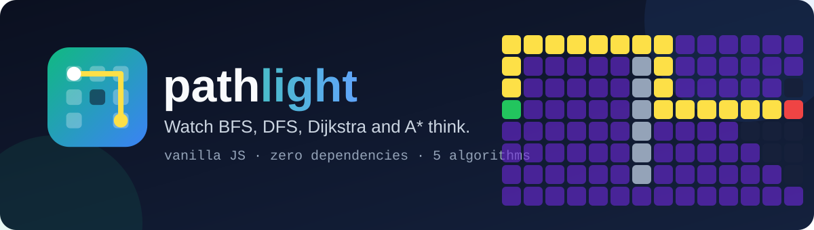
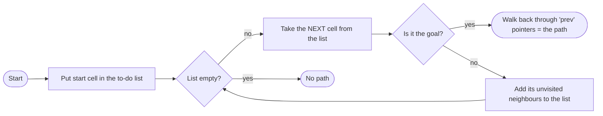

<div align="center">



<br/>

[](https://github.com/YOUR_USERNAME/pathlight/actions)
[](https://YOUR_USERNAME.github.io/pathlight/)
[](src/algorithms.js)
[](package.json)
[](LICENSE)
[](https://github.com/YOUR_USERNAME/pathlight/stargazers)

### 🔦 See how BFS, DFS, Dijkstra and A\* actually think.

**Draw walls and mud, drag the start and goal, and watch five pathfinding algorithms race through your maze. One page, no build step, zero dependencies.**

[**▶ Open the live demo**](https://YOUR_USERNAME.github.io/pathlight/)

[✨ Features](#-features) •
[🎮 Controls](#-controls) •
[🧠 How it works](#-how-it-works) •
[📊 Compare](#-the-algorithms-compared) •
[💻 Run locally](#-run-locally) •
[🗺️ Roadmap](#%EF%B8%8F-roadmap)

</div>

<!-- Tip: record a short GIF of the demo, save it as assets/demo.gif, then uncomment the line below.
<p align="center"></p>
-->

---

## ✨ Features

| | Feature | Details |
|:--:|---|---|
| 🧭 | **5 algorithms** | BFS, DFS, Dijkstra, A\*, Greedy Best-First |
| 🎨 | **Draw anything** | Walls block, mud costs 5x. Click a cell again to erase it |
| 🖱️ | **Drag and drop** | Move the start and goal anywhere, on desktop or touch |
| 🎞️ | **Live animation** | Frontier, visited cells and final path, with a speed slider |
| 📊 | **Live stats** | Cells visited, path length and path cost for every run |
| 🎲 | **Random boards** | One click for a random maze with walls and mud |
| 🧪 | **Tested core** | Results checked against an independent Bellman-Ford solver |
| 🪶 | **Featherweight** | Vanilla JS, no framework, no bundler, no dependencies |

---

## 🎮 Controls

| Action | How |
|---|---|
| Draw walls or mud | Click or drag on the grid (pick the tool in the toolbar) |
| Erase | Start on a cell that is already a wall or mud, then drag |
| Move start (green) or goal (red) | Drag them |
| Run | **▶ Run** |
| Reset | **Clear path** keeps your maze. **Clear board** wipes everything |
| Change speed | Speed slider (works while idle or running) |

---

## 🧠 How it works

> **The big idea:** all five algorithms are the *same loop*. The only difference is **what kind of to-do list** they use.



The "to-do list" is where the personality comes from:

| Algorithm | To-do list | "Next cell" means | Data structure |
|---|---|---|---|
| **BFS** | Queue | the oldest one | `Queue` |
| **DFS** | Stack | the newest one | `Stack` |
| **Dijkstra** | Priority queue by `g` | cheapest cost **so far** | `MinHeap` |
| **A\*** | Priority queue by `g + h` | cheapest so far **+ a guess to the goal** | `MinHeap` |
| **Greedy** | Priority queue by `h` | looks closest to the goal | `MinHeap` |

`g` is the real cost already paid, and `h` is the Manhattan distance to the goal (a guess that never overestimates, which is why A\* stays optimal). In code it is a single function, [`search()`](src/algorithms.js), and swapping algorithms is one line:

```js
import { createGrid, solve } from './src/algorithms.js';

const grid = createGrid(22, 40);          // 22 rows x 40 cols, cells are ids: row * cols + col
const result = solve('astar', grid, 0, 879);

result.found    // true
result.path     // [0, 1, 2, ...]  cell ids from start to goal
result.cost     // total cost of the path
result.visited  // how many cells the algorithm had to look at
```

Want to animate it yourself? `search()` is a **generator**, so you can pull one step at a time:

```js
for (const step of search('dijkstra', grid, start, goal)) {
  // step = { type: 'visit' | 'frontier', id }
}
```

---

## 📊 The algorithms compared

Real output from [`node examples/compare.js`](examples/compare.js) on the default 40x22 board.

**Open board** (no walls)

| Algorithm | Cells visited | Path cost | Optimal? |
|---|--:|--:|:--:|
| BFS | 617 | 27 | ✅ |
| DFS | 220 | 219 | ❌ |
| Dijkstra | 622 | 27 | ✅ |
| **A\*** | **28** | 27 | ✅ |
| Greedy | 28 | 27 | ✅ |

**Walls plus a patch of mud**

| Algorithm | Cells visited | Path cost | Optimal? |
|---|--:|--:|:--:|
| BFS | 788 | 75 | ❌ (ignores mud) |
| DFS | 397 | 345 | ❌ |
| Dijkstra | 765 | 43 | ✅ |
| **A\*** | **324** | 43 | ✅ |
| Greedy | 112 | 85 | ❌ |

### What to take away

- **BFS** is perfect when every step costs the same, but it walks straight through mud.
- **DFS** finds *a* path quickly, but rarely a good one.
- **Dijkstra** is always optimal, even with mud, but explores in all directions.
- **A\*** gets the same optimal answer while looking at **far fewer cells**, because the heuristic points it at the goal.
- **Greedy** is the fastest to run, but it can be fooled by walls and mud.

---

## 💻 Run locally

```bash
git clone https://github.com/YOUR_USERNAME/pathlight.git
cd pathlight
npm start          # serves the folder at http://localhost:8000
```

(ES modules need a web server, so double-clicking `index.html` won't work. Any static server is fine.)

Run the tests (Node 18+):

```bash
npm test
```

### 🌍 Host it free on GitHub Pages

1. Push to GitHub.
2. **Settings → Pages → Build and deployment → Source: Deploy from a branch**.
3. Choose branch `main`, folder `/ (root)`, and save.
4. Your demo goes live at `https://YOUR_USERNAME.github.io/pathlight/`.

---

## 🗂️ Project structure

```text
pathlight/
├── 📄 index.html            # the whole UI (HTML + CSS)
├── 📁 src/
│   ├── algorithms.js        # BFS, DFS, Dijkstra, A*, Greedy + MinHeap
│   └── app.js               # canvas drawing, mouse/touch input, animation
├── 📁 tests/                # node:test suite, checked against Bellman-Ford
├── 📁 examples/compare.js   # prints the comparison tables above
├── 📁 assets/               # logo and banner (SVG)
├── 📁 .github/workflows/    # CI on Node 18, 20, 22
├── package.json
├── LICENSE
└── README.md
```

---

## 🗺️ Roadmap

- [x] Five algorithms on one shared framework
- [x] Weighted cells (mud)
- [x] Drag-and-drop start and goal
- [ ] Maze generators (recursive division, Prim's)
- [ ] Diagonal movement and a heuristic switcher
- [ ] Bidirectional search and Jump Point Search
- [ ] Side-by-side race mode
- [ ] Export the run as a GIF

Have an idea? [Open an issue](https://github.com/YOUR_USERNAME/pathlight/issues).

---

## 🤝 Contributing

Beginner-friendly PRs are very welcome. Adding a new algorithm usually means writing a new frontier or heuristic inside `search()` and adding a test.

1. Fork the repo and create a branch: `git checkout -b feature/my-idea`
2. Add a test in `tests/` and run `npm test`
3. Open a pull request

---

## 📜 License

Released under the [MIT License](LICENSE).

<div align="center">

<br/>

**If pathlight helped you finally *get* A\*, please give it a ⭐**

<sub>Built with 💚 while learning Data Structures and Algorithms.</sub>

</div>
